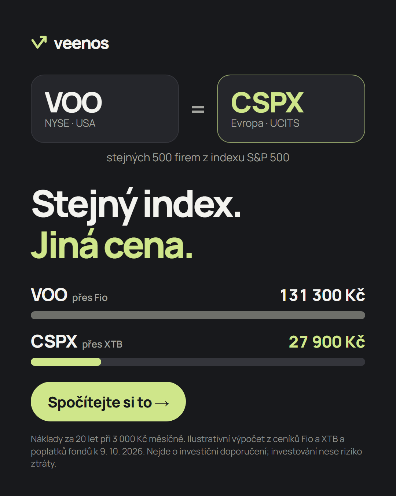
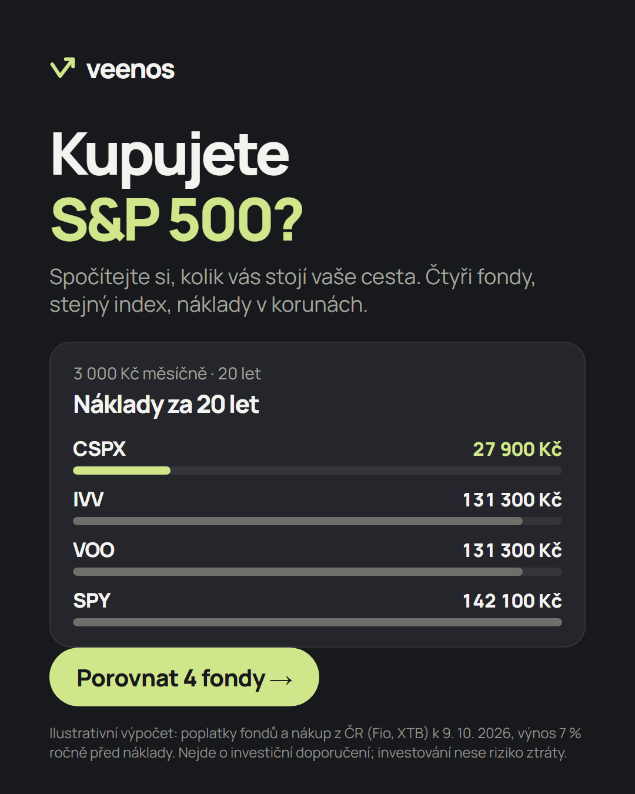

# Veenos: porovnanie S&P 500 ETF z NYSE pre českého investora (Zadanie B)

**Stránka:** https://veenos.vercel.app · **Repo:** https://github.com/Matush77/Clientelo-task-b
**Reklamy:** [`ads/`](ads/) · **Meranie funnelu:** `/api/stats?token=…&format=html` · **Export konverzácií:** [`ai-log/`](ai-log/)

Mobilná lead-magnet stránka v češtine. Návštevník z reklamy za pár sekúnd vidí, že **SPY, IVV a VOO (NYSE Arca) a európsky CSPX sledujú rovnaký index S&P 500, ale z Česka ho stoja úplne iné peniaze**. Dvoma ťuknutiami (suma, roky) dostane porovnanie štyroch fondov v korunách. Za meno a e-mail mu príde podrobný rozpis; telefón dá len vtedy, keď sám chce pomôcť („Chci pomoct").

> Projekt je ukážka pre výberové konanie. Všetko, čo by pri ostrom spustení ešte chýbalo, je v časti [Čo chýba](#čo-chýba).

---

## 1. Cieľová skupina
**„Kutil", ktorý pozná S&P 500:** investuje sám (XTB, Trading 212, Degiro) alebo s tým práve začína, tickery pozná z YouTube a sociálnych sietí a rieši poplatky, menu a dane. Prečo práve on:
- Na českom fóre FinExpert sa najviac diskutuje o UCITS tickeroch (VWCE 185 príspevkov, IWDA 141, SPYL 106, SXR8 78), o TER, FX a časovom teste (`research/01-audience.md`, citácie overené v logu A6).
- 39 % Čechov investuje; neinvestorov brzdí strach zo straty (73 %), nedostatok peňazí (71 %) a znalostí (71 %); hlavná motivácia je dôchodok (78 %). Raiffeisenbank, 7/2026, overené A2.
- Meta cielenie je aj tak široké (konkurencia beží na celú ČR, 18–65+). Segment preto určuje **text a hĺbku obsahu, nie cielenie**.

## 2. Čo návštevník dostane a kedy žiadame kontakt
| Kedy | Čo dostane | Čo dá |
|---|---|---|
| Hneď po 2 ťuknutiach | 4 fondy zoradené podľa celkových nákladov v Kč (poplatok fondu + nákup z ČR) | nič |
| Po kliknutí „Poslat srovnání e-mailem" | e-mail: celý rozpis po fondoch, čo z toho plynie, predpoklady a zdroje, návod na nákup ETF | meno + e-mail (autofill) |
| Voliteľne „Chci pomoct" | jeden telefonát k postupu (broker, výpočet) | telefón |

**Hodnota je viditeľná ešte pred formulárom** (požiadavka zadania), formulár sa otvorí až po výsledku. Rovnaký vzor používajú Portu, Fondee aj Finax (`research/02-competitors.md`). Telefón je opt-in: kontakt je kvalitnejší a zároveň máme výslovný súhlas s hovorom (§96 zák. 127/2005 Sb., `research/decisions.md` D5b, D5c).

## 3. Poradie sekcií a prečo
1. **Hero:** „Stejný index. Jiná cena." + 1 veta + 3 krátke odrážky + 1 CTA. Nadväzuje na obe reklamy (message match +39–48 % v dvoch testoch, log C10) a prejde 2-sekundovým testom: čo to je, čo z toho mám, kam kliknúť. Na desktope je kalkulačka priamo v hero vedľa nadpisu.
2. **Kalkulačka:** len 2 voľby (mesačne, roky) na jednej karte, žiadne písanie. Podľa zadania sú interaktívne prvky cestou ku kontaktu.
3. **Výsledok:** 4 pruhy na jednej škále, najlacnejší zvýraznený. Toto je samotné **porovnanie ETF z NYSE**, ktoré zadanie žiada, s európskym dvojčaťom ako kontrolou z pohľadu Čecha.
4. **Formulár (bottom sheet / dialóg):** až po výsledku, 2 povinné polia, autofill.
5. **Jak počítáme:** zdroje a predpoklady pre skeptikov, pod výsledkom, aby nebrzdili. Počíta sa z rovnakých dát ako kalkulačka.
6. **Pätička:** upozornenie (nejde o investičné odporúčanie), ochrana údajov, nastavenie cookies.

Cookie lišta sa ukáže pri prvej návšteve (mobil: karta, tablet: stred, desktop: lišta cez celú šírku). Kým je viditeľná, hero sa posunie, aby CTA nezakrývala.

## 4. Reklamy (2 verzie)
Detaily, texty a UTM odkazy: [`ads/README.md`](ads/README.md).

| A: porovnávacia karta (VOO = CSPX) | B: otázka „Kupujete S&P 500?" |
|---|---|
|  |  |

Kanál je **Meta (Facebook + Instagram)**: Google Ads vyžaduje od 9/2026 overenie finančného inzerenta a TikTok licenciu (log D1, D2).

## 5. Dáta a zdroje (skutočné, s dátumom)
Jediný zdroj pravdy je [`public/js/model.js`](public/js/model.js). Pri každom údaji je URL a dátum; stránka, e-mail aj testy počítajú z neho.

| Údaj | Hodnota | Zdroj |
|---|---|---|
| TER SPY / IVV / VOO | 0,0945 % / 0,03 % / 0,03 % | State Street, iShares, Vanguard (stránky fondov) |
| TER CSPX (UCITS, IE00B5BMR087) | 0,07 % | justETF |
| Burza SPY, IVV, VOO | NYSE Arca | Nasdaq Trader `otherlisted.txt` (overené E3) |
| Fio: americký trh | 7,95 USD za pokyn, kurzová prirážka ≈ 3 % (orientačne) | cenník Fio od 1. 7. 2026, kurzová tabuľka (E5) |
| XTB | 0 % provízia, konverzia 0,5 % | cenník XTB z 29. 4. 2026 |
| Kurz USD | 21,745 Kč (9. 10. 2026) | ČNB API (E4) |
| Prečo len Fio | americké ETF nemajú KID (PRIIPs), väčšina brokerov ich retailu v EÚ nepredáva | DEGIRO, LYNX, Saxo, Fio (E2, E6) |

Predpoklady: výnos 7 % p. a. pred nákladmi pre všetky fondy (rovnaký index), mesačný vklad, americké fondy nakupované raz za štvrťrok (férovejšie než mesačné pokyny po 7,95 USD), na konci predaj a spätná konverzia.

## 6. Meranie celej cesty
Funnel sa meria **bez cookies**: prehliadač posiela udalosti cez `sendBeacon`, prepojené len ID v pamäti stránky. Na server sa neukladá IP adresa, iba denné počty podľa varianty, zariadenia a reklamy (`utm_content`).

`page_view → hero_cta → calc_select → calc_compare → result_view → form_open → form_start → help_on → form_submit → lead_ok / lead_error` (+ `consent_accept/reject`)

Prehľad je na `/api/stats?token=…&format=html`: funnel podľa A/B varianty, zariadenia a reklamy plus počet leadov. GA4 a Meta Pixel sú pripravené v [`public/js/config.js`](public/js/config.js), načítajú sa iba po súhlase a v tejto ukážke sú vypnuté (prázdne ID). Cookie lišta je súčasťou ukážky.

**Overenie kvality (11. 10. 2026, produkcia):**
- **Lighthouse mobile:** Performance **96**, Accessibility **100**, Best Practices **100**, SEO **100**; LCP 2,3 s, CLS 0, TBT 60 ms. Prvý beh odhalil CLS 0,10 (cookie lišta sa pridávala až po vykreslení) a slabý kontrast jedného riadku; oboje opravené.
- **Testy:** 15 automatických testov (`npm test`) a end-to-end v prehliadači na 390 / 768 / 1440 px.
- **Ostrý test:** 1 testovací lead na produkcii (so súhlasom), e-mail odoslaný cez Brevo.

## 7. Očakávaná konverzia
**Odhad: 4–8 % návštev → lead, stred okolo 6 %.**

- **Benchmarky** (Unbounce 2024, mediány stránok, ktoré mali aspoň nejaké konverzie, teda skôr optimistické): finančné služby 8,3 %, investovanie 3,9 %, finance z paid social 9,3 %, finance na mobile 11,5 % (log C1). Quiz/kalkulačkové funnely: 7,85–11,28 % (priemery, C9).
- **Odhad podľa krokov funnelu:**

  | Krok | Pesimisticky | Stred | Optimisticky |
  |---|---|---|---|
  | príchod → porovnanie | 30 % | 42 % | 50 % |
  | porovnanie → otvorenie formulára | 25 % | 35 % | 40 % |
  | formulár → lead | 45 % | 55 % | 60 % |
  | **výsledok** | **3,4 %** | **8,1 %** | **12,0 %** |

- Stred zaokrúhľujem nadol na ~6 %, lebo benchmarky sú optimistické a cieľová skupina je skeptická (73 % Čechov si myslí, že reklamy preháňajú; WPP Media 2025, `research/03`).
- Pri CPC 8–12 Kč (slabé vstupy: CPM 3,5–5 USD, CTR ~1 %) to znamená **CPL zhruba 130–200 Kč**. Reálne číslo dá až meranie.

## 8. Tri hypotézy na A/B test (zoradené podľa očakávaného dopadu)
| # | Hypotéza | Metrika | Prečo tento dopad | Vzorka* |
|---|---|---|---|---|
| 1 | **Čiastočný výsledok + zvyšok za e-mail** (ukázať víťaza a rozdiel, plné porovnanie až po e-maile) zvýši podiel otvorení formulára oproti plnému porovnaniu na stránke. | `form_open / calc_compare`, `lead_ok / page_view` | Moment žiadosti je najsilnejšia páka na objem leadov. Riziko: dôvera a kvalita leadov. Kontrolovaná štúdia k načasovaniu brány neexistuje (`research/03`), treba ju otestovať. | ~1 000 / variant na úrovni kroku |
| 2 | **Variant B (mladý muž + „Spočítat poplatky")** zvýši preklik z hero oproti A (Pražský hrad + „Začít investovat"). „Začít investovat" sľubuje otvorenie účtu, ale klik otvorí kalkulačku. | `hero_cta / page_view`, `calc_compare / page_view` | Prvá obrazovka rozhoduje o všetkom ďalšom. Pozor: B mení fotku aj CTA naraz, je to test celej „mladšej" varianty a nepovie, ktorý z dvoch prvkov zabral. | ~1 000 / variant |
| 3 | **Len e-mail (bez mena)** zvýši dokončenie formulára oproti menu + e-mailu. | `lead_ok / form_open` | Menej polí obvykle pomáha (Baymard, Imagescape), ale pri 2 poliach s autofillom je efekt menší, preto až tretia. | ~1 300 / variant |

\* Hrubý odhad pre 80 % silu a α = 0,05 (n ≈ 16·p(1−p)/δ²). Celková konverzia 6 % → +20 % relatívne by vyžadovala ~6 300 návštev na variant, preto sa testy vyhodnocujú na úrovni konkrétneho kroku funnelu. Varianta stránky sa dá vynútiť cez `?v=a|b` (napr. z reklamy), inak 50/50 pri každom načítaní.

## 9. Ako som pracoval s AI
Celý projekt vznikol v Claude Code. Hlavný agent bol **Claude Opus 5.5**, výskum robilo **5 paralelných subagentov Claude Sonnet 5.5**. Kompletný priebeh je v [`ai-log/`](ai-log/): hlavná konverzácia + prepis každého subagenta (automatický export cez hook `scripts/export_ai_log.py` a `/export`).

**Postup:**
1. **Plán bez rozhodnutí.** Najprv plán výskumu; rozhodnutia o segmente, magnete a dizajne mali prísť až z dát a spolu so mnou.
2. **Výskum, 5 agentov naraz:** publikum, konkurencia (5 CZ/SK + 3 zahraničné weby), konverzná psychológia, reklamy + compliance, dáta + dane. **Presné pokyny** sú v [`research/prompts/`](research/prompts/). Spoločné pravidlá: každé tvrdenie s URL a dátumom, značka `VERIFIED`/`INFERRED`, citácie pod 15 slov, nič nevypĺňať na cudzích weboch, **iba možnosti, žiadne odporúčania**. Každý agent na konci uviedol 3 tvrdenia, ktorými si je najmenej istý.
3. **Kontrola výstupov.** Hlavný agent znova otvoril zdroje **35 tvrdení** (prednostne čísla, právo a tvrdenia, ktorými si agenti neboli istí): [`research/99-verification-log.md`](research/99-verification-log.md). Výsledok: 28 potvrdených, 5 čiastočne, 1 nesprávne, 1 nerozhodnuteľné, 2 nedostupné. Chyby sú opravené priamo v reportoch s odkazom na log.
4. **Decision brief → rozhodnutia.** [`research/00-decision-brief.md`](research/00-decision-brief.md) dal ku každému rozhodnutiu 2–4 možnosti s dôkazmi. Rozhodoval som ja (často proti odporúčaniu AI), všetko je zapísané v [`research/decisions.md`](research/decisions.md) (13 kôl).
5. **Dizajn v 13 iteráciách** ([`design/previews/`](design/previews/)): od piatich „dátových" smerov (všetky zamietnuté ako preplnené) cez minimal fintech, výber farby, loga a fotky až po responzívnu verziu. Kľúčový zásah: **AI sa odklonila od zadania** (porovnávala dve cesty k jednému indexu, nie ETF z NYSE), všimol som si to ja a stránka sa vrátila k porovnaniu 4 fondov.
6. **Build podľa schváleného plánu** ([`research/build-plan.md`](research/build-plan.md)) s testami (15 unit testov) a end-to-end kontrolou v prehliadači na 3 veľkostiach obrazovky.

**Kde sa AI mýlila (a ako sa to chytilo):**
- **Výskumní agenti správne opisovali čísla, no zle interpretovali ich rozsah.** Pridali tickery, ktoré zdroj neuvádzal (A1); „stabilný podiel 14 %" vyložili ako 14 % populácie (A3, nesprávne); celkovú vzorku štúdie priradili jednej podskupine (C4); domysleli detail („ponuka bola príručka", C3); dobrú prax ÚOOÚ označili za povinnosť (D4). Poučenie: značka `VERIFIED` znamená „otvoril som stránku", nie „čítam ju správne".
- **Hlavný agent sám:** do pokynov pre agenta E vložil zastaraný fakt (limit 40 mil. Kč pre časový test, od 2026 zrušený). Agent ho podľa Finančnej správy opravil (L1). Poučenie: pokyny majú klásť otázky, nie tvrdiť fakty z pamäte modelu.
- **Odklon od zadania:** pri riešení prekážky PRIIPs sa koncept posunul na „dve cesty k S&P 500" a vypadlo porovnanie ETF z NYSE. Opravené po mojej pripomienke (`decisions.md` D0b, D4b).
- **Dizajn:** prvých 5 smerov bolo preplnených dátami. Náhľady boli zmenšené na 66 % a AI to najprv nespomenula. Nadpis „Jiná" kolidoval s riadkom nad ním. Reklamy sa najprv vykreslili v náhradnom fonte (cesta k fontu cez `file://`). Na reklame zostalo „zdarma", hoci som ho zo stránky predtým odstránil.
- **Kód:** `form.name` vracal atribút formulára namiesto inputu (chytené pri návrhu), dialóg zameriaval tlačidlo zavrieť namiesto prvého poľa (chytené pri teste v prehliadači), skript na inline náhľadov sa raz commitol prázdny (opravené ďalším commitom).

## 10. Rozhodnutia tam, kde zadanie nebolo jednoznačné
- **„ETF obchodované na NYSE" vs. realita v ČR:** americké ETF väčšina brokerov českému retailu nepredá (PRIIPs). Stránka preto porovnáva **SPY, IVV, VOO z NYSE Arca** a ako kontrolu pridáva **európske dvojča CSPX**, ktoré sa z ČR kúpiť dá. Porovnanie ETF z NYSE zostáva jadrom, realita nákupu je jeho súčasťou.
- **Len S&P 500:** najčistejší príbeh „rovnaký index, iná cena" a všetky údaje overené. Svet (VT) a celý trh USA (VTI) potrebujú overiť TER.
- **„NYSE" = NYSE Arca:** tam sú SPY, IVV aj VOO kótované; QQQ je na Nasdaqu, preto chýba (E3).
- **Formulár:** zadanie chce čo najmenej polí. Povinné sú 2 (meno, e-mail) s autofillom; telefón je dobrovoľný a s výslovným účelom. Meno je kompromis kvôli kvalite leadu, preto je hypotézou č. 3.
- **Jazyk:** stránka a reklamy po česky (cieľová skupina), README po slovensky (zadávateľ), oslovenie „vy" (všetky české finančné weby, C6).

## Čo chýba
Ukážka je hotová a nasadená, pri ostrom spustení by ešte bolo treba:
- **Údaje prevádzkovateľa a právna kontrola** (zásady ochrany údajov, upozornenia); otázka, či vzdelávací porovnávač neprekročí hranicu investičného odporúčania (MAR, ČNB). Hovor „Chci pomoct" musí zostať pomocou s postupom, nie radou ku konkrétnemu fondu.
- **Meta:** či vyžaduje od nelicencovaného vydavateľa overenie (neoverené, D6). Google Ads je bez finančného overenia zatvorený.
- **E-maily z vlastnej domény:** Brevo zo sendera na Gmaile môže padať do spamu (DMARC). Odhlasovanie pre „tipy e-mailem" je len uložený súhlas, newsletter systém neexistuje.
- **Licencia fotky:** Unsplash licencia komerčné použitie povoľuje, pred spustením ju treba potvrdiť alebo fotku kúpiť a hostovať u seba.
- **Hosting:** Vercel Hobby je na nekomerčné použitie, reálna kampaň potrebuje Pro alebo iný hosting.
- **Dáta:** Fio kurzová prirážka je orientačná (tabuľka bez dátumu), dáta treba pravidelne obnovovať (zatiaľ ručne v `model.js`).
- **Meranie:** GA4/Meta Pixel sú vypnuté, takže Meta nemá konverzný signál na optimalizáciu. A/B variant sa neukladá, opakovaná návšteva môže dostať druhú variantu.
- **Rozsah:** iba S&P 500.

## Štruktúra repozitára a spustenie
```
public/           stránka (index, návod, ochrana údajov), model.js (dáta + výpočet), app.js, fonty, og.png
api/              lead.js (formulár → Redis + e-mail), event.js (funnel), stats.js (prehľad)
lib/              store (Upstash / pamäť), mailer (Brevo / konzola), email-template, validate
tests/            node:test – model, API, e-mail (15 testov)
ads/              2 reklamy (HTML → PNG), texty a UTM
research/         zadanie, prompty agentov, 5 reportov, verifikačný log, decision brief, rozhodnutia, build plán
design/previews/  13 iterácií dizajnu (v13 = schválená predloha)
ai-log/           export konverzácií s Claude Code (hlavná + subagenti)
scripts/          dev server, export ai-logu, render reklám, kopírovanie fontov
```
```bash
npm install
npm test          # 15 testov
npm run dev       # http://localhost:3000 (bez účtov: úložisko v pamäti, e-maily do mail-outbox/)
```
Produkcia (Vercel): premenné `UPSTASH_REDIS_REST_URL/TOKEN` (alebo `KV_REST_API_*` z integrácie), `BREVO_API_KEY`, `MAIL_FROM`, `MAIL_FROM_NAME`, `TEAM_EMAIL`, `STATS_TOKEN`, `SITE_URL`. Pozri [`.env.example`](.env.example).
